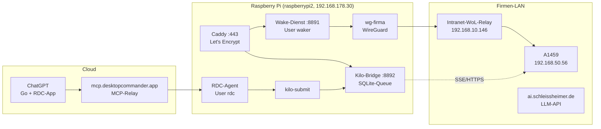
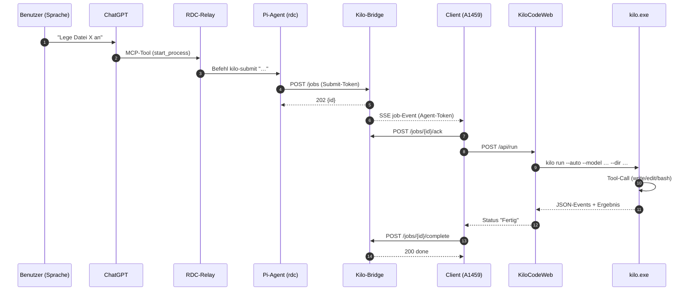
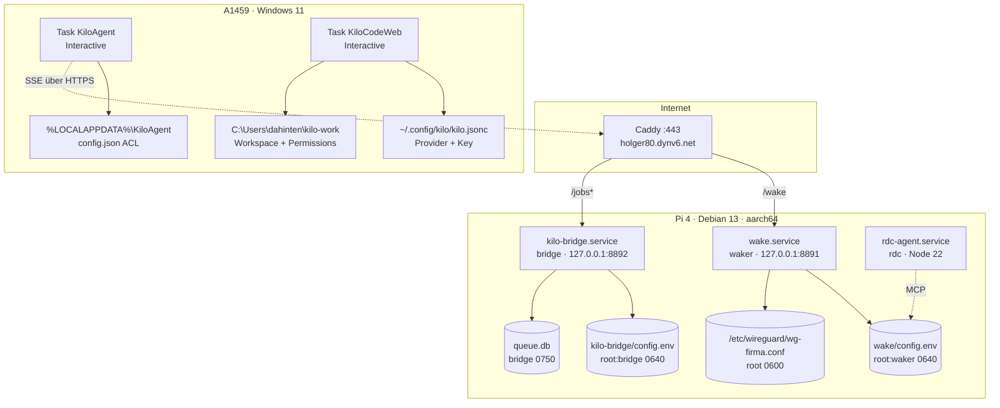
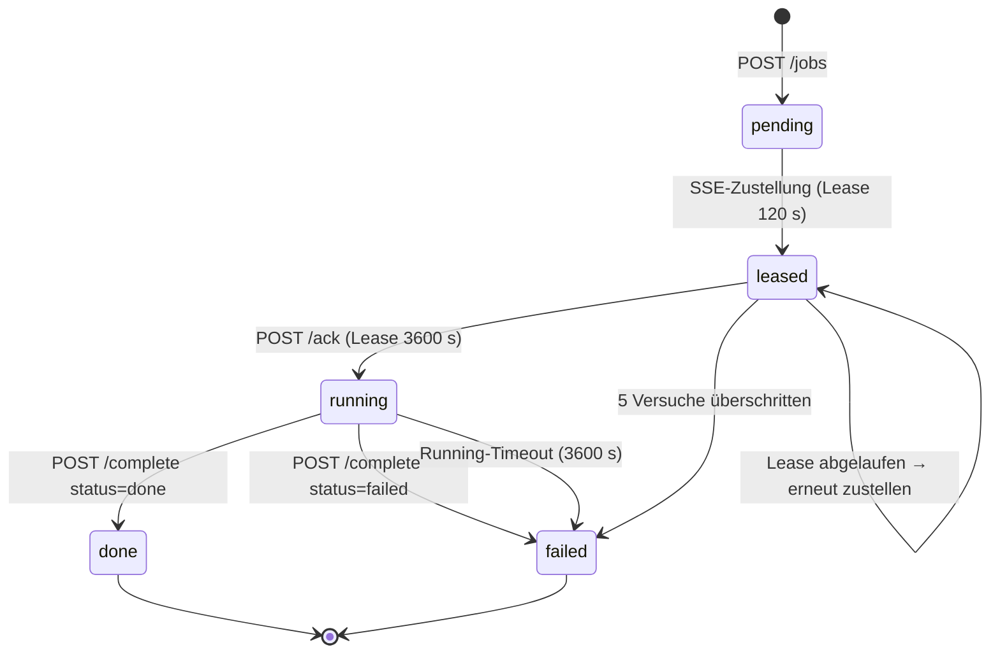

# Architektur

## Überblick

Zwei getrennte Wege laufen über denselben Raspberry Pi:

1. **Auftragsweg** – ChatGPT → RDC-Connector → Pi-Agent → Queue → Firmen-PC → Kilo Code.
2. **Weckweg** – beliebiger HTTPS-Client → Caddy → Wake-Dienst → WireGuard → Firmen-LAN-Relay → Magic Packet.

## Datenfluss eines Auftrags

## Deployment

## Zustandsmodell der Queue

## Netzwerkpfade

| Pfad | Protokoll | Anmerkung |
|---|---|---|
| ChatGPT → `mcp.desktopcommander.app` | HTTPS/MCP | ausgehend vom Pi-Agenten; Drittanbieter-Relay |
| Client A1459 → Pi | HTTPS + SSE | ausgehend, Port 443, kein Inbound im Firmennetz |
| Pi → `ai.schleissheimer.de` | HTTPS | nur lokal auf A1459 (CLI), nicht vom Pi |
| Pi → `192.168.10.146` | HTTP über `wg-firma` | WoL-Relay im Intranet |
| Pi → `192.168.50.56` | TCP 3389 über `wg-firma` | nur Erreichbarkeitsprüfung |

Der Pi baut `wg-firma` ausschließlich für den Wake-Vorgang auf und trennt die
Verbindung wieder, wenn er sie selbst gestartet hat. Der Auftragsweg braucht
kein VPN auf dem Pi.
