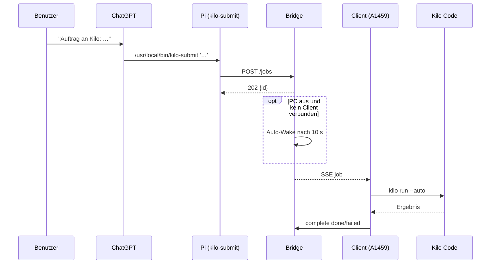

# Aufträge über ChatGPT

ChatGPT führt keinen Code auf dem Firmen-PC aus. Es reicht den Auftrag über den
RDC-Agenten auf dem Pi ein; den Rest übernehmen Bridge, Auto-Wake und der Client.

## Kurzprompt (zum Kopieren)

> Führe über Remote Desktop Commander auf `raspberrypi2` exakt diesen Befehl aus
> und gib nur die Ausgabe zurück. Lege keine Dateien an und interpretiere den
> Auftrag nicht selbst:
>
> `/usr/local/bin/kilo-submit '<Auftragstext>'`

Erwartete Antwort:

```json
{"http": 202, "status": "accepted", "message": "Auftrag angenommen", "id": "…"}
```

## Dauerhaft abkürzen

Einstellungen → Personalisierung → Eigene Anweisungen:

```
Wenn ich "Auftrag an Kilo: <Text>" sage, führe auf raspberrypi2 über
Remote Desktop Commander exakt aus:
/usr/local/bin/kilo-submit '<Text>'
Lege dabei keine Dateien an, interpretiere <Text> nicht selbst und gib nur die
JSON-Antwort samt Job-ID zurück.
```

Danach genügt:

> Auftrag an Kilo: Erstelle im Workspace ein Python-Skript, das die CPU-Last misst.

Oder per Sprache in der mobilen App denselben Satz diktieren.

## Regeln für den Auftragstext

| Regel | Grund |
|---|---|
| max. 8192 Zeichen | Bridge-Limit (`MAX_INSTRUCTION`) |
| **keine einfachen Anführungszeichen** (`'`) | würden den Shell-Befehl beenden |
| kein Markdown, keine Backticks | wird sonst als Shell-Syntax interpretiert |
| ein Auftrag pro Aufruf | Queue ist pro Auftrag gedacht |
| Text unverändert übergeben | Kilo Code soll die Originalformulierung erhalten |
| Zielordner nicht nennen | der Workspace ist fest (`KILO_WORK`) |

Beispiel für eine Formulierung ohne verbotene Zeichen:

> Auftrag an Kilo: Lege im Workspace die Datei demo.txt mit dem Inhalt Hallo an.

## Was im Hintergrund passiert



## Ergebnis prüfen

```bash
kilo-log --job <id> --since 1h
kilo-log --since 15m --follow
```

Auf dem Firmen-PC:

```powershell
Get-Content "$env:LOCALAPPDATA\KiloAgent\state\agent.log" -Tail 20
Get-Content "C:\Tool\logs\kiloweb.jsonl" -Tail 20
```

## Typische Fehler

| Symptom | Ursache / Abhilfe |
|---|---|
| ChatGPT legt die Datei selbst an, Queue bleibt leer | Prompt war nicht eindeutig; „lege keine Dateien an" und den exakten Befehl nennen |
| `400 bad_request` | Text zu lang, leer oder mit Anführungszeichen zerschossen |
| `429 rate_limited` | mehr als 10 Aufträge pro Minute |
| `507 queue_full` | mehr als 100 offene Aufträge |
| `502 relay_error` / `504 vpn_timeout` | nur beim Wake-Pfad; `kilo-log --source wake` prüfen |
| Auftrag bleibt `pending` | PC aus und Auto-Wake fehlgeschlagen; `wake-now` manuell ausführen |
| `done`, aber Datei fehlt | Modell hat keinen echten Tool-Call gemacht; `kilo-log` und KiloCodeWeb-Protokoll prüfen |

## Sicherheitsgrenze

Der Befehl ist der einzige vorgesehene Weg. ChatGPT hat als Benutzer `rdc`
technisch Shell-Zugriff auf dem Pi – deshalb:

- Submit-Token nur für `POST /jobs`, rate-limited.
- Kilo Code läuft nur im Workspace mit restriktiven Permissions.
- Keine Firmendaten in den Auftragstext schreiben, wenn sie nicht auf dem Pi
  oder in der Kilo-Ausführung erscheinen dürfen.

## Manuell ohne ChatGPT

```bash
/usr/local/bin/kilo-submit 'Lege im Workspace die Datei demo.txt an.'
curl -sS -X POST https://holger80.dynv6.net/jobs \
  -H "Authorization: Bearer $SUBMIT_TOKEN" \
  -H "Content-Type: application/json" \
  -d '{"instruction":"Lege im Workspace die Datei demo.txt an."}'
```
